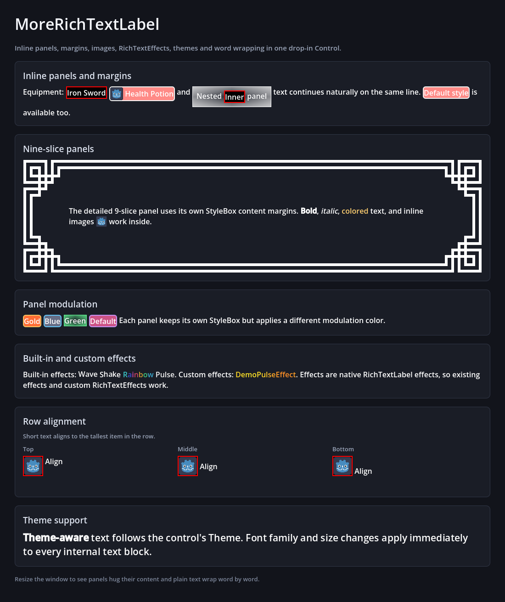
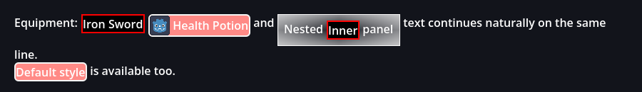
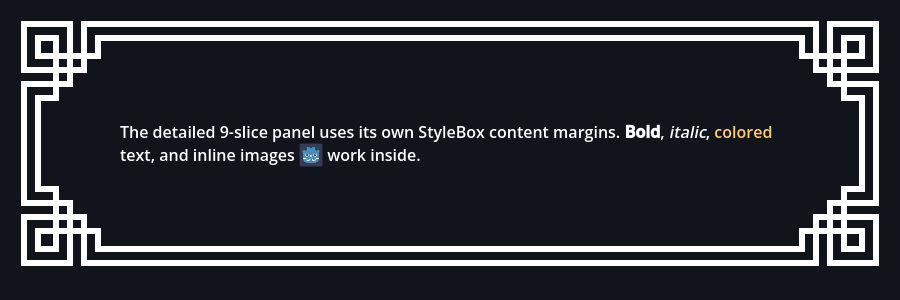
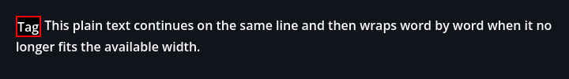
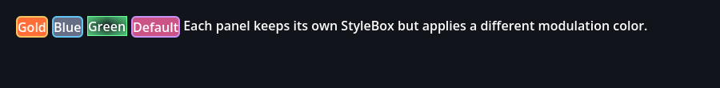
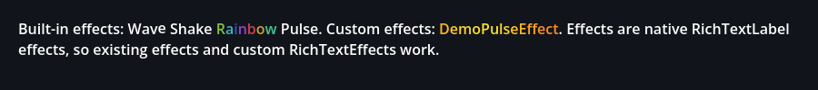
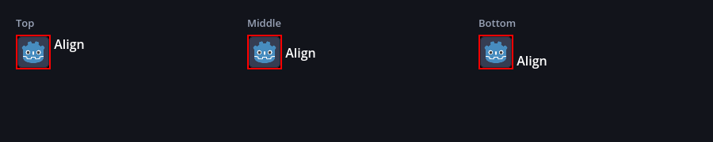

# MoreRichTextLabel

Drop-in `RichTextLabel` replacement for Godot 4.7+ with **inline panels**, **inline margins**, images, RichTextEffects, themes, and custom vertical row alignment.

The addon keeps RichTextLabel's text engine, so existing BBCode, images, built-in effects, and custom `RichTextEffect` resources continue to work.



## Features

- Inline `[panel=res://stylebox.tres]` boxes that hug their content.
- `[panel]` shorthand using an exported default StyleBox.
- Nested panels and margins.
- Any `StyleBox`: `StyleBoxFlat`, `StyleBoxTexture`, 9-slice panels, custom StyleBox resources.
- Per-panel modulation: `[panel=... modulate=#ffcc66]`.
- Inline images with `[img=WxH]res://image.png[/img]`.
- Full RichTextLabel formatting: bold, italics, colors, links, built-in effects.
- Custom `RichTextEffect` support.
- Row alignment: Top, Middle, Bottom.
- Theme-aware font family and font size updates without reloading the scene.
- Editor preview with `[Tool]`/`@tool`.
- C#, GDScript, and an optional static TextServer renderer.

## Installation

### C#

Copy this single file into your project:

```text
addons/more_rich_text_label/MoreRichTextLabel.cs
```

Build the project, then attach `MoreRichTextLabel.cs` to a `Control` node. The class is also registered globally, so it appears in the Add Node dialog.

### GDScript

Copy this single file into your project:

```text
addons/more_rich_text_label/MoreRichTextLabelGD.gd
```

The class name is `MoreRichTextLabelGD`.

### Optional static TextServer renderer

Copy this single file if you need a faster static renderer:

```text
addons/more_rich_text_label/experimental/TextServerRichTextLabel.cs
```

It is self-contained and can coexist with `MoreRichTextLabel.cs`.

## Quick start

```csharp
using MoreRichTextLabelLib;

var label = new MoreRichTextLabel
{
    Text = "A [panel=res://ui/sword_panel.tres]Sword[/panel] and " +
           "[panel=res://ui/potion_panel.tres]Potion[/panel] in the same line."
};

label.DefaultPanelStyle = GD.Load<StyleBox>("res://ui/default_panel.tres");
AddChild(label);
```

Or set `Text` directly in the inspector.

## Inline panels and margins

Panels and margins behave like inline boxes. They shrink to fit their content, capped by the available width. Plain text around them stays on the same line when it fits and wraps word-by-word when it does not.



```bbcode
Equipment:
[panel=res://stylebox/black_red.tres]Iron Sword[/panel]
[panel=res://stylebox/pink_white_cornered.tres][img=28x28]res://icon.svg[/img] Health Potion[/panel]
and [panel=res://stylebox/nine_slice_small.tres][margin=8]Nested [panel=res://stylebox/black_red.tres]Inner[/panel] panel[/margin][/panel]
text continues naturally.
```

Panel padding comes from the StyleBox content margins, exactly like `PanelContainer`. Nested margins add more inset space.

### StyleBox example



```bbcode
[panel=res://stylebox/nine_slice_detailed.tres]
The detailed 9-slice panel uses its own content margins.
[b]Bold[/b], [i]italic[/i], and [color=#ffcf70]colored[/color] text work inside.
[/panel]
```

### Margin syntax

```bbcode
[margin=8]all sides[/margin]
[margin=8,12]horizontal, vertical[/margin]
[margin=8,4,8,4]left, top, right, bottom[/margin]
```

### Word wrapping



Plain text after an inline panel fills the remaining line and wraps word-by-word.

## Panel modulation

Each panel can tint its StyleBox independently:



```bbcode
[panel=res://stylebox/pink_white_cornered.tres modulate=#ffcc66]Gold[/panel]
[panel=res://stylebox/pink_white_cornered.tres modulate=#66ccff]Blue[/panel]
[panel=res://stylebox/nine_slice_small.tres modulate=#66ff99]Green[/panel]
[panel modulate=#cc99ff]Default style, tinted[/panel]
```

Supported forms:

```bbcode
[panel=res://stylebox.tres modulate=#ffcc66]...[/panel]
[panel panel=res://stylebox.tres modulate=#ffcc66]...[/panel]
[panel path=res://stylebox.tres modulate=#ffcc66]...[/panel]
[panel modulate=#ffcc66]...[/panel]
```

The modulate value is a Godot color string, such as `#ffcc66`, `#ffcc66cc`, or `gold`.

Modulation applies to the StyleBox itself: flat background, border and shadow colors, texture modulate color, and line color. Custom StyleBox subclasses that do not expose colors may ignore the modulation.

## Effects



Built-in effects work normally:

```bbcode
[wave]Wave[/wave]
[shake]Shake[/shake]
[rainbow]Rainbow[/rainbow]
[pulse]Pulse[/pulse]
```

Custom effects can be installed through `CustomEffects`:

```csharp
var effect = GD.Load<RichTextEffect>("res://effects/MyEffect.tres");
label.CustomEffects = new Godot.Collections.Array<RichTextEffect> { effect };
label.Text = "[my_effect]Animated text[/my_effect]";
```

Any `RichTextEffect` resource placed in the exported `CustomEffects` array is installed on every internal text block.

Effects are limited to a single text block. An effect tag cannot span across a `[panel]` or `[margin]` boundary.

## Row alignment



```csharp
label.RowAlignment = InlineRowAlignment.Top;    // default
label.RowAlignment = InlineRowAlignment.Middle;
label.RowAlignment = InlineRowAlignment.Bottom;
```

In GDScript the property is `row_alignment` with `Top`, `Middle`, `Bottom` options.

## Themes

Set a `Theme` on the control as usual. Internal text blocks inherit it and update immediately when font family or font size changes.

```csharp
var theme = new Theme();
theme.SetFontSize("normal_font_size", "RichTextLabel", 22);
theme.SetFontSize("bold_font_size", "RichTextLabel", 22);
label.Theme = theme;
```

Use RichTextLabel theme items such as `normal_font`, `normal_font_size`, `bold_font`, `italics_font`, and `default_color`. BBCode font tags are optional and still work.

## Editor preview

The control is a `[Tool]`/`@tool` script. It builds internal preview labels in the editor. Generated text blocks are internal children and are not saved into your scene.

## TextServer renderer

`TextServerRichTextLabel.cs` is a static, self-contained alternative renderer:

- Supports panels, margins, images, bold/italic, row alignment.
- Does not render colors, RichTextEffects, or custom effects.
- Uses a separate namespace: `MoreRichTextLabelLib.Experimental`.

Use it when static layout speed matters more than full RichTextLabel behavior.

## Demo

Run the project or open:

```text
demo/Demo.tscn
```

The demo covers inline panels, nested margins, StyleBoxes, panel modulation, images, built-in effects, custom effects, row alignment, and themes.

To regenerate the README images:

```powershell
godot_console.exe --path . res://demo/CaptureScreenshots.tscn
```

Images are written to `docs/images/`.

## Limitations

- Word-by-word wrapping applies to plain text runs. Runs containing formatting or effect tags remain atomic so effects and markup stay intact.
- Selection works per internal text block, not across panel boundaries.
- Effects can draw outside the control bounds. Enable **Clip Contents** on the control if effects should stay inside it.
- The static TextServer renderer intentionally has a reduced feature set.

## Project layout

```text
addons/more_rich_text_label/
  MoreRichTextLabel.cs
  MoreRichTextLabelGD.gd
  experimental/
    TextServerRichTextLabel.cs

demo/
  Demo.tscn
  Demo.cs
  CaptureScreenshots.tscn
  CaptureScreenshots.cs
  effects/

docs/
  images/

bench/
  Development benchmarks and regression tests.
```
